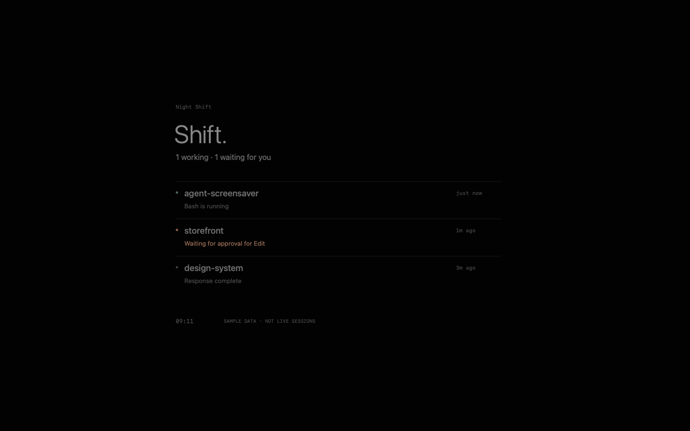

# Night Shift

A quiet macOS screensaver for Claude Code. See which projects are working,
waiting for you, or finished—on a nearly black screen. When no sessions are
present, just the name, “Idle.” and a clock remain.

[English](README.md) · [Türkçe](README.tr.md)



## Download and install

Download an edition from the [latest release](https://github.com/mcongara/nightshift-screensaver/releases/latest):

- **EN** — `NightShift-0.2.0-macOS-arm64-EN.zip`: English interface and installer.
- **TR** — `NightShift-0.2.0-macOS-arm64-TR.zip`: Turkish interface and installer.

Extract the entire ZIP, run `Install.command` (EN) or `Kur.command` (TR), then
select **Night Shift** in macOS Screen Saver settings. Restart Claude Code
sessions to load the hooks. Set a Hot Corner or an automatic screensaver start
time to activate it.

Requires **Apple Silicon, macOS 15+, Python 3.9+**, and local Claude Code with
hooks enabled. Prebuilt ZIPs do not require Xcode. Each edition replaces the other
and shares preferences and session data. Only one edition is installed at a time.

The downloads are **ad-hoc signed and not notarized**. macOS may block downloaded
packages. The installer does not change security settings or remove quarantine
flags. See the [English install guide](docs/INSTALL.en.md) or
[Turkish install guide](docs/INSTALL.tr.md) for details and removal instructions.

## Build from source

Requires Xcode command-line tools in addition to the runtime requirements above.
There are no third-party runtime dependencies.

```sh
git clone https://github.com/mcongara/nightshift-screensaver.git
cd nightshift-screensaver

# Build one language (default: tr), or both.
bash scripts/build.sh en
# bash scripts/build.sh tr
# bash scripts/build.sh all

# Inspect the installation plan, then install the selected edition.
python3 scripts/install.py --language en --dry-run
python3 scripts/install.py --language en
```

Outputs live in `build/en/` and `build/tr/`. Language is selected at compile time:
**Shift. / Idle.** in English and **Vardiya. / Bekliyor.** in Turkish. The status
rows, Options sheet and previews use the selected language too. Existing hook
data is translated by the view; switching editions does not require new sessions.

```sh
# Development preview; never prevents sleep.
build/en/NightShiftPreview --demo
build/en/NightShiftPreview --scenario empty --snapshot build/idle-en.png

# Build and package both editions.
bash scripts/build.sh all
python3 scripts/package.py all

# Or package one edition after building it.
python3 scripts/package.py en

# Remove either installed edition; preserve other Claude hooks and local data.
python3 scripts/install.py --uninstall
```

ZIPs are created under `build/`, with installers, a guide in the selected language,
the license and the prebuilt components. The packager uses an explicit allowlist;
it includes no personal settings, session state, build caches or repository history.

## Behavior and privacy

- A real `.saver` module, a per-user loopback bridge and a native lifecycle monitor.
  No menu bar app, cloud account or API key is needed.
- Hooks collect hashed session IDs, project folder basenames, event timestamps,
  broad status and tool type. No prompts, transcripts, commands, full paths or
  model responses are stored. Hook handlers fail open and produce no output.
- “Response complete” means the response ended, not that the overall task succeeded.
  Subagent hooks are ignored so they do not overwrite root-session status.
- Hooks are events, not heartbeats. After 15 minutes without an event, status is
  explicitly unknown; after 24 hours the session is hidden. Long silent tools can
  appear unknown. Existing sessions are not discovered retroactively at install.
- Optional keep-awake prevents display and system **idle** sleep while the actual
  screensaver is active. Previews cannot enable it. Stop/unlock and lease expiry
  release protection; `caffeinate` has a 30-second hard timeout. This does not
  prevent lid-close or manual sleep or change screen brightness or lock settings.
- The bridge binds to `127.0.0.1:47831`. Other local processes can read generic
  session state. There is no command-execution endpoint; browser-origin writes
  are rejected. Preferences are saved under
  `~/Library/Application Support/NightShift/preferences.json`.
- Options: text brightness, clock visibility, hidden project names and keep-awake.
  On Tahoe, reopening Screen Saver settings can help a delayed Options sheet.

## Validation

```sh
python3 -m unittest discover -s tests -v
bash scripts/check-feed.sh
bash scripts/check-localization.sh
```

Tests cover hook lifecycle, privacy, concurrency, additive settings merges,
loopback HTTP, wake leases, feed reconnect/cancellation, localization and packaging.
Native screensaver hosting and sleep behavior still need testing on each target
macOS version. Local development testing used macOS 26. Screenshots use sample data.

## Contributing

Issues and pull requests are welcome. Include your macOS version, chosen edition,
reproduction steps and redacted error messages. Build both editions and run the
checks above before submitting UI or packaging changes.

## License

[MIT](LICENSE).
