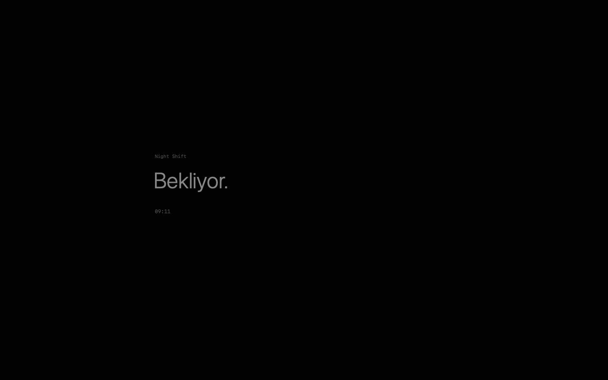

# Night Shift

Claude Code için sade bir macOS ekran koruyucu. Hangi projenin çalıştığını,
hangisinin seni beklediğini ve hangi yanıtın tamamlandığını loş bir ekranda gösterir.
Session yokken yalnızca **Night Shift**, **Bekliyor.** ve saat görünür.

[English](README.md) · [Türkçe](README.tr.md)



## Hazır ZIP ile kurulum

[Son sürümden](https://github.com/mcongara/nightshift-screensaver/releases/latest)
istediğin dili indir:

- **TR:** `NightShift-0.2.0-macOS-arm64-TR.zip` — Türkçe arayüz ve kurulum.
- **EN:** `NightShift-0.2.0-macOS-arm64-EN.zip` — İngilizce arayüz ve kurulum.

ZIP'in tamamını aç, TR için `Kur.command`, EN için `Install.command` dosyasını
çalıştır. macOS Ekran Koruyucu ayarlarında **Night Shift**'i seç. Hook'ların
alınması için Claude Code sessionlarını yeniden aç. Otomatik başlama süresi veya
Sıcak Köşe ayarla.

**Apple Silicon Mac, macOS 15+, Python 3.9+ ve yerel Claude Code** gerekir.
Hazır ZIP için Xcode veya derleme gerekmez. TR ve EN birbirinin yerine kurulur;
aynı ayarları ve verileri kullanır.

Paket ad-hoc imzalıdır; Developer ID imzası ve Apple notarizasyonu yoktur.
macOS indirdiğin paketi engelleyebilir. Kurucu güvenlik ayarlarını değiştirmez.
Ayrıntılar: [Türkçe kurulum kılavuzu](docs/INSTALL.tr.md).

## Kaynaktan derleme

Ek olarak Xcode komut satırı araçları gerekir. Üçüncü taraf çalışma zamanı
bağımlılığı yoktur.

```sh
git clone https://github.com/mcongara/nightshift-screensaver.git
cd nightshift-screensaver
bash scripts/build.sh tr
# İngilizce: bash scripts/build.sh en
# İkisi: bash scripts/build.sh all
python3 scripts/install.py --language tr --dry-run
python3 scripts/install.py --language tr
```

Çıktılar `build/tr/` ve `build/en/` altındadır. Dil derleme sırasında seçilir:
TR'de **Vardiya. / Bekliyor.**, EN'de **Shift. / Idle.** kullanılır. Durum metinleri
ve Seçenekler paneli de çevrilir.

```sh
# Örnek verili önizleme; uyku engeli açmaz.
build/tr/NightShiftPreview --demo

# Her iki hazır ZIP'i üret.
bash scripts/build.sh all
python3 scripts/package.py all

# Testler.
python3 -m unittest discover -s tests -v
bash scripts/check-feed.sh
bash scripts/check-localization.sh

# Kaldır; diğer Claude hook'ları ve yerel veriler korunur.
python3 scripts/install.py --uninstall
```

## Davranış ve gizlilik

Session kimliğinin özeti, proje klasörünün adı, son hook zamanı, genel durum ve
araç türü tutulur. Prompt, konuşma, komut içeriği, tam dosya yolu veya model yanıtı
tutulmaz. Hazır paketlerde kişisel ayar veya session verisi bulunmaz.

Hook'lar düzenli yaşam sinyali değildir. 15 dakika yeni olay gelmezse durum
bilinmiyor olur; 3 saat sonra session gizlenir. “Yanıt tamamlandı”, bütün işin
başarıyla bittiği anlamına gelmez. Alt ajan hook'ları ana durumu değiştirmez.

İsteğe bağlı uyanık tutma yalnızca gerçek ekran koruyucu açıkken otomatik ekran
ve sistem uykusunu engeller. Çıkışta korumayı bırakır. Önizleme tek başına uyku
engelleyemez. Kapak kapatma, elle Uyku ve kilit ayarları değişmez.

Yerel köprü yalnızca `127.0.0.1:47831` üzerinde çalışır; API anahtarı gerekmez.
Diğer yerel süreçler genel session durumunu okuyabilir. Ayarlardan metin parlaklığı,
saat, proje adlarının gizlenmesi ve uyanık tutma seçilebilir.

Tailscale üzerindeki bir makinenin bağlantısını göstermek için
`~/Library/Application Support/NightShift/machine.json` dosyasına
`{"host": "tailscale-makine-adi", "name": "Etiket"}` yaz. Dosya yoksa bir şey değişmez.

Teknik ayrıntılar ve katkı adımları [İngilizce README](README.md) içindedir.
Sorun bildirirken macOS sürümünü, seçilen dili ve tekrar etme adımlarını ekle;
özel bilgileri çıkar.

## Lisans

[MIT](LICENSE).
